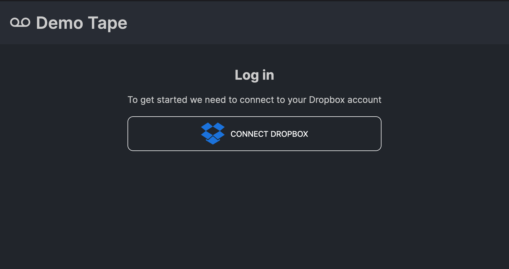
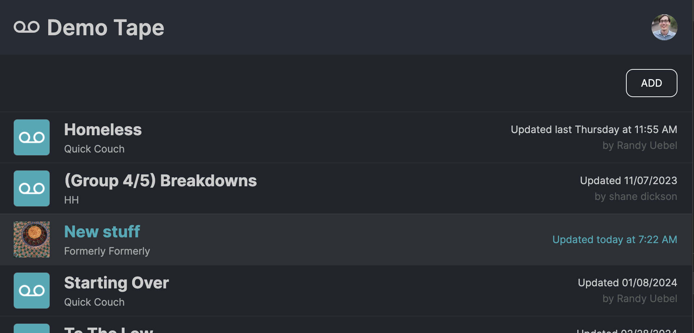
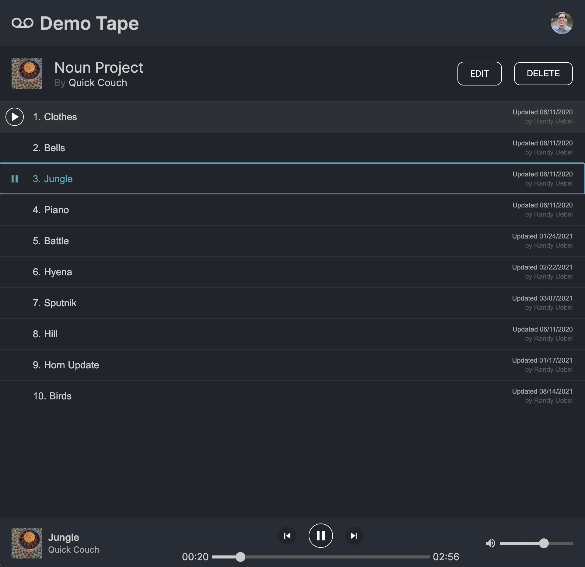
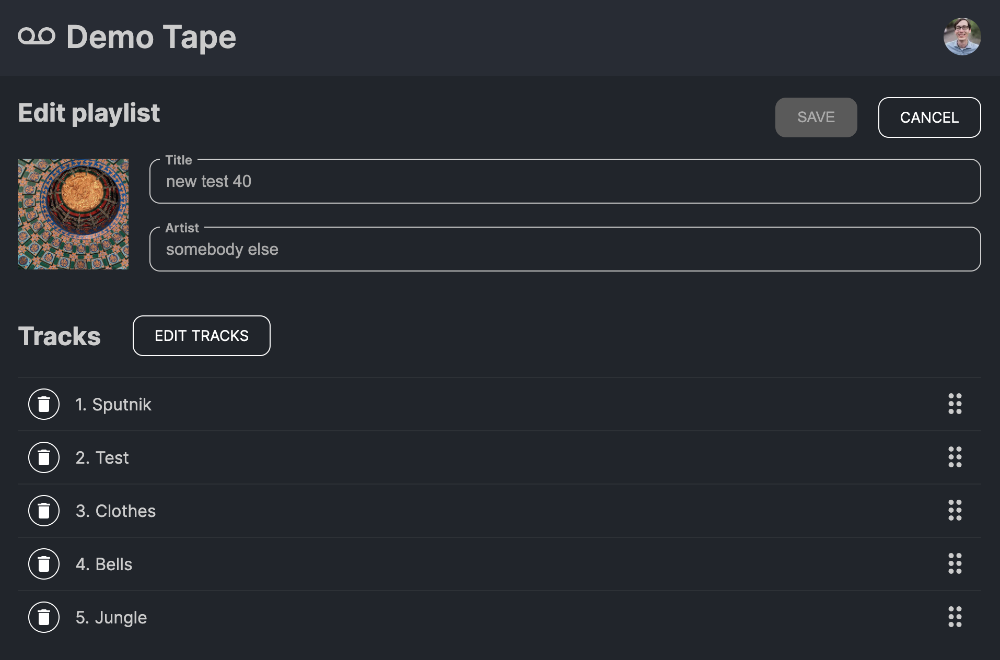
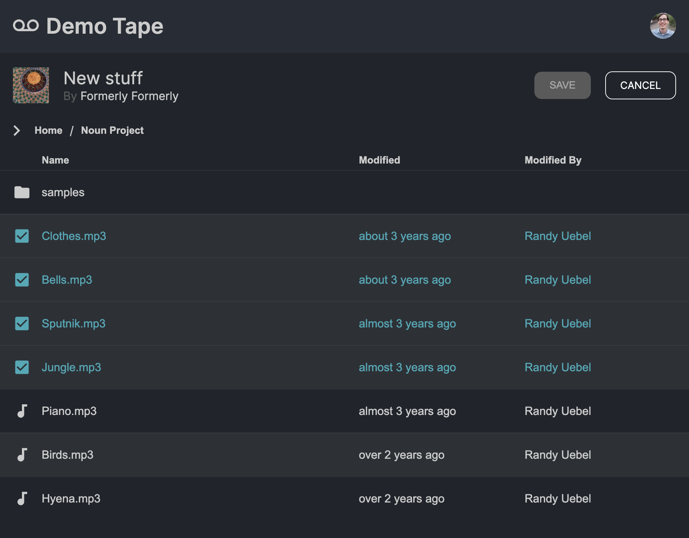

# Dropbox Demo Tape

> A collaborative playlist app built on Dropbox

https://dropbox-demo-tape.vercel.app/

## Overview

- Create and listen to collaborative playlists in Dropbox
- Anyone with permissions to the file in Dropbox can collaborate

### Login

Log in to Dropbox to start



### Playlists

- View all of the playlists you have access to
- Playlists are saved as `.mix` files in Dropbox
- Playlists can be shared with friends by giving them access to your `.mix` files



### Listen to your Playlists



### Edit Playlist

Edit playlist details.



Select tracks from Dropbox.

_You won't need to reselect the tracks when you upload new versions as long as the file name stays the same._



### Folder Playlists

Choose "Sync a folder" when you create a playlist to make a playlist from a Dropbox folder.

- Every audio file directly in the folder is in the playlist. Files in subfolders are not.
- New files show up and deleted files go away while the playlist is open.
- Tracks are in file name order ("Track 2" comes before "Track 10"). Drag tracks on the edit page to change the order. New files then go at the end. "Sort A–Z" goes back to file name order.
- The `.mix` file is saved in the folder, so sharing the folder also shares the playlist.
- The playlist is named after the folder unless you type another title.

## Technology

- [React](https://react.dev/)
- [Typescript](https://www.typescriptlang.org/)
- [Jotai](https://jotai.org/)
- [NextJS](https://nextjs.org/)
- [Vercel](https://vercel.com/)

## Development

To install dependencies

```console
npm install
```

To run locally

```console
npm run dev
```

### Dropbox Client Id

You will need a dropbox client id

1. [Create an app](https://www.dropbox.com/developers/apps?)
2. Add `{your_deployment_url}/auth` to the `Redirct URIs`
3. Copy the App key and update the key in `./constants.ts`
